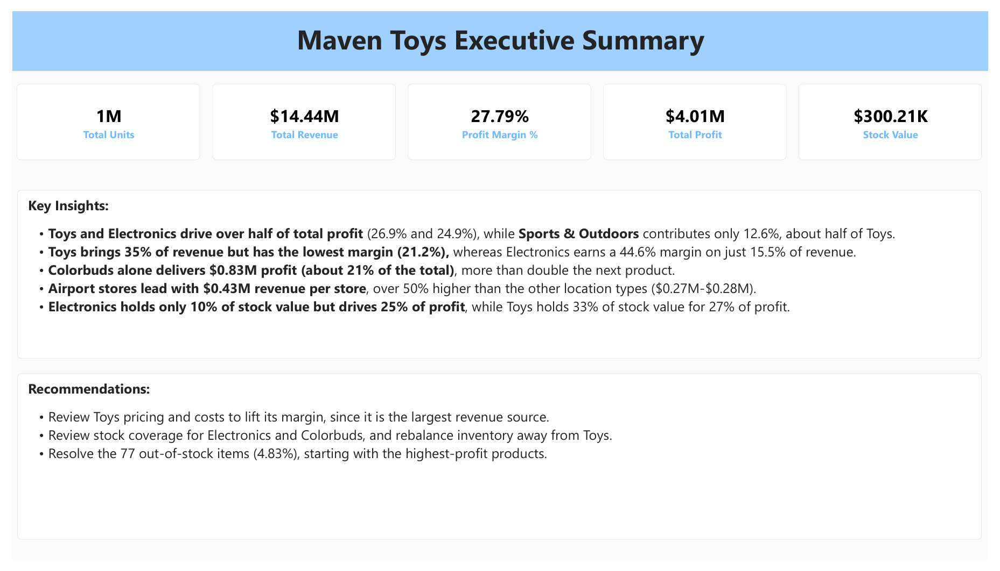
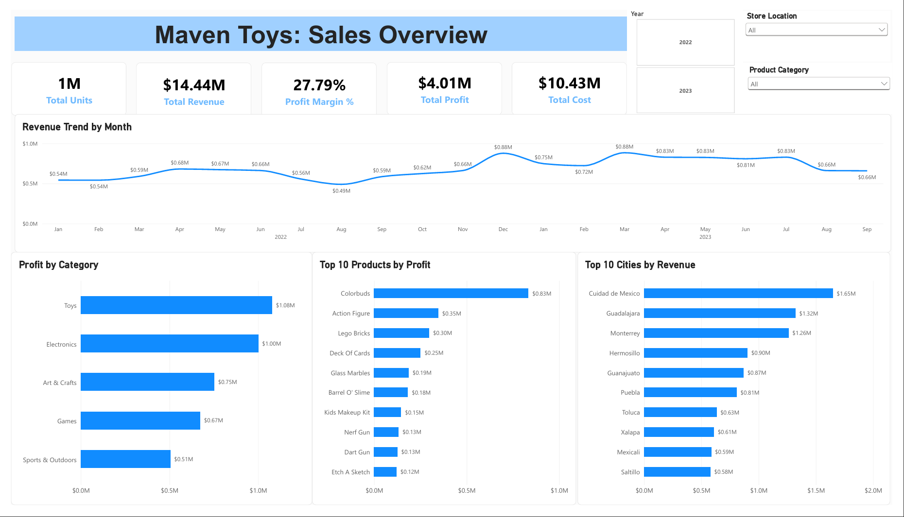
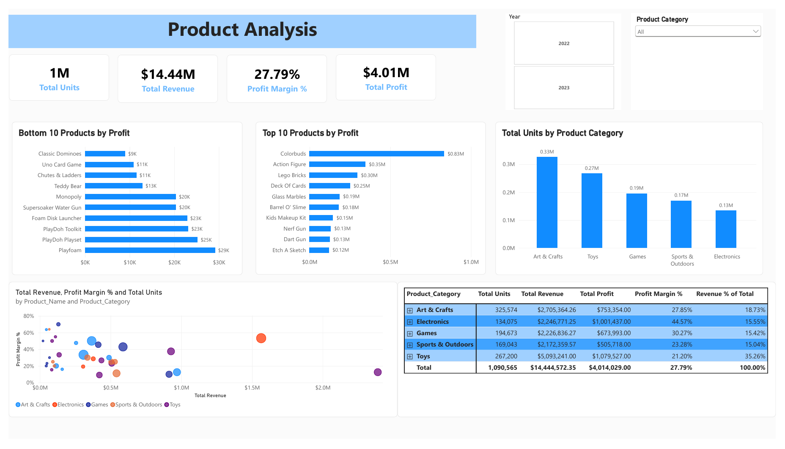
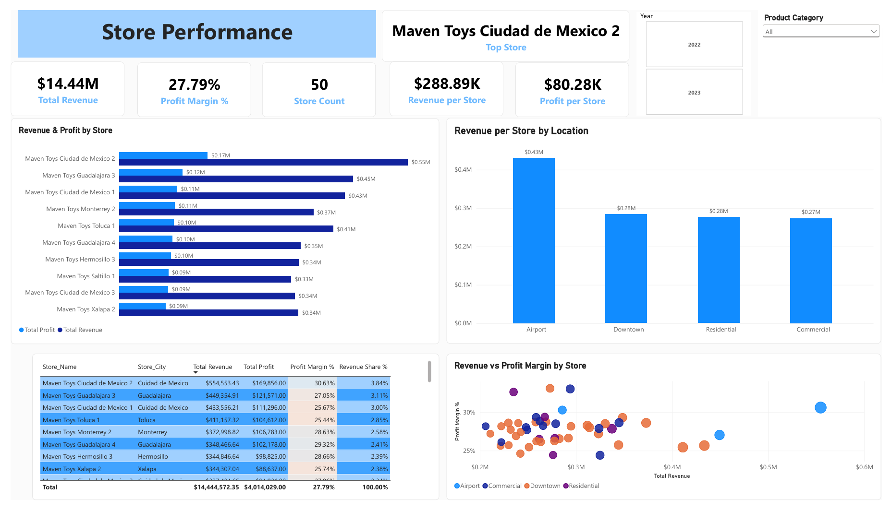
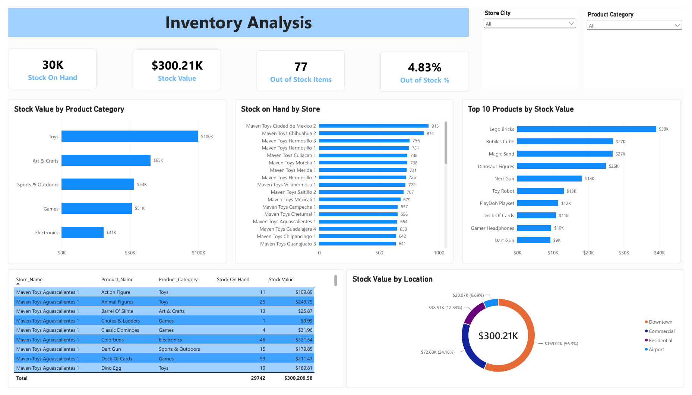

# Maven Toys Sales Analysis Dashboard (Power BI)

An end-to-end Power BI report analyzing sales, profit, store performance and inventory for **Maven Toys**, a chain of toy stores across Mexico.

**Period:** Jan 2022 – Sep 2023 | **Stores:** 50 | **Revenue:** $14.44M | **Profit:** $4.01M | **Margin:** 27.79%



---

## Business Questions

1. Which product categories and products drive profit, and which ones lag?
2. Which stores and location types perform best?
3. Is inventory aligned with what actually makes money?
4. What should the business do next?

## Dataset

Public "Mexico Toy Sales" dataset from [Maven Analytics](https://mavenanalytics.io/data-playground) (sales, products, stores, inventory).

## Tools

- **Power BI Desktop** (data modeling, DAX measures, visuals)

## Report Pages

| Page | Focus |
|---|---|
| **Sales Overview** | Revenue trend by month, profit by category, top products, top cities |
| **Product Analysis** | Top/bottom products by profit, units by category, revenue vs. margin |
| **Store Performance** | Revenue and profit by store, revenue per store by location type |
| **Inventory Analysis** | Stock value, out-of-stock items, stock by store and location |
| **Executive Summary** | KPIs, key insights and recommendations on one page |

Pages 1–4 include slicers (Year, Product Category, Store Location / City where relevant).

## Key Insights

- **Toys and Electronics generate 52% of total profit**, while Sports & Outdoors contributes only 12.6%.
- **Toys brings 35% of revenue but has the lowest margin (21.2%)**, whereas Electronics earns a 44.6% margin on just 15.5% of revenue.
- **Colorbuds alone delivers $0.83M profit (about 21% of the total)**, more than double the next product.
- **Airport stores lead with $0.43M revenue per store**, over 50% higher than the other location types ($0.27M–$0.28M).
- **Electronics holds only 10% of stock value but drives 25% of profit**, while Toys holds 33% of stock value for 27% of profit.

## Recommendations

1. Review Toys pricing and costs to lift its margin, since it is the largest revenue source.
2. Review stock coverage for Electronics and Colorbuds, and rebalance inventory away from Toys.
3. Resolve the 77 out-of-stock items (4.83%), starting with the highest-profit products.

## Limitations

- **Inventory data is a snapshot** of stock on hand, with no sales velocity per product. The stock recommendation is a review prompt, not a proven shortage.
- **Airport stores are few** (3 visible in the store scatter chart), so the Airport result rests on a small sample.
- The dataset covers about 21 months only, so seasonal patterns are based on a short history.

## Report Screenshots

| Sales Overview | Product Analysis |
|---|---|
|  |  |

| Store Performance | Inventory Analysis |
|---|---|
|  |  |

## Repository Structure

```
maven-toys-power-bi/
├── README.md
├── Maven_Toys_Dashboard.pbix
├── Maven_Toys_Dashboard.pdf
└── images/
    ├── 01_sales_overview.png
    ├── 02_product_analysis.png
    ├── 03_store_performance.png
    ├── 04_inventory_analysis.png
    └── 05_executive_summary.png
```

## How to Use

Download `Maven_Toys_Dashboard.pbix` and open it with Power BI Desktop (free), or view the PDF export.

## Author

**[Mohamed Hassan]** | [LinkedIn](https://www.linkedin.com/in/mohammedhassan95) | [Email](mohamed_hassan_95@yahoo.com)
